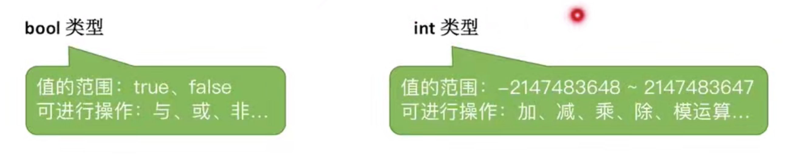
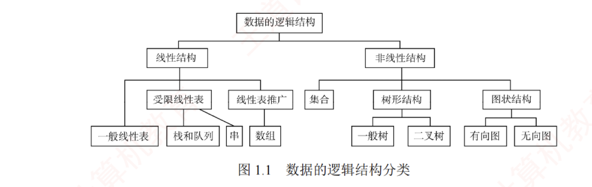

---

### 基本概念和术语

1. 数据
   >数据是**信息的载体**，是描述客观事物属性的数、字符，以及所有能输入到计算机中并被计算机程序识别和处理的符号的**集合**。数据是计算机程序加工的原料。
   
2. 数据元素
   >数据元素是**数据**的**基本单位**，通常作一个整体进行考虑和处理。一个数据元素可由若干数据项组成，**而数据项是构成数据元素的不可分割的最小单位**。例如，一条学生记录就是一个数据元素，它由学号、姓名、性别等数据项组成。
   
3. 数据对象
   >数据对象是具有**相同性质**的数据元素的集合，是**数据的一个子集**。例如，整数数据对象可表示为集合$N=\{0,\pm 1,\pm 2,……\}$
   
4. 数据类型
   >数据类型是**一个值的集合**以及定义在该集合上的一组操作的总称。

	**图中包含了值的集合以及集合上的操作**
   

	- **原子类型**：其值不可再分的数据类型。

	- **结构类型**：其值可进一步分解为若干成分（分量）的数据类型。

	- **抽象数据类型**（ADT）：一个数学模型以及定义在该模型上的一组操作。它通常是对数据的某种抽象，规定了数据的取值范围、结构形式以及可执行的操作集合。

### 数据结构三要素

1. 数据的**逻辑结构**
   >逻辑结构是指**数据元素之间的逻辑关系**，即从**逻辑**角度对数据的**描述方式**。它与数据在计算机中的**存储方式无关**，是**独立**于具体系统的。数据的**逻辑结构**可分为**线性结构和非线性结构**。例如，线**性表**是典型的线性结构；集合、树和图则是典型的**非线性结构**.
   
   **图示为数据的逻辑结构分类**
   
>	集合中的数据元素只有**同属于一个集合**这一种关系
>	线形结构中的数据元素之间仅存在**一对一**的关系
>	树形结构中的数据元素之间存在**一对多**的关系
>	图状结构或者说是网状结构的数据元素之间存在**多对多**的关系

2. 数据的存储结构
   >**存储结构**是指数据结构在计算机中的**表示形式**，也称**物理结构**，包括**数据元素的表示**及其相**互关系的表示**。它是**逻辑结构**在计算机中的**具体实现**，依赖于所采用的编程语言。常见的存储结构有**顺序存储、链式存储、索引存储和散列存储。**
   
   - **顺序存储**：将**逻辑上相邻**的数据元素存储在**物理位置也相邻**的存储单元中，元素间的关系由存储单元的**邻接关系**体现。优点是可以实现**随机存取**，每个元素占用**最少的存储空间**；缺点是要求使用**连续的存储空间**，可能导致较多的**外部碎片**。

   - **链式存储**：**不要求**逻辑上相邻的元素在物理位置上也相邻，而是通过**指针**指示元素的存储地址来表示其逻辑关系。优点是**不会出现碎片现象**，能充分利用所有存储单元：缺点是每个元素因存储指针而**额外占用存储空间**，且**只能顺序存取**。

   - **索引存储**：在存储元素信息的同时，额外建立**索引表**。索引表中的每一项称为索引项， 通常包含**关键字和地址**。优点是**检索速度快**；缺点是需要**额外的存储空间用于索引表**， 且增加或删除数据时需**更新索引表**，带来**额外的时间开销**。

   - **散列存储**：根据元素的**关键字**直接计算出其**存储地址**，也称**哈希（Hash）存储**。优点是检索、插入和删除操作都非常**快速**；缺点是如果**散列函数设计不当**，可能会产生**冲突**（也称哈希冲突），解决冲突会增加**时间和空间成本**。

3. 数据的运算
   >数据的运算包括**定义与实现**两个方面：定义针对**逻辑结构**，说明运算的**功能**；实现则基于**存储结构**，描述**具体的操作步骤**。